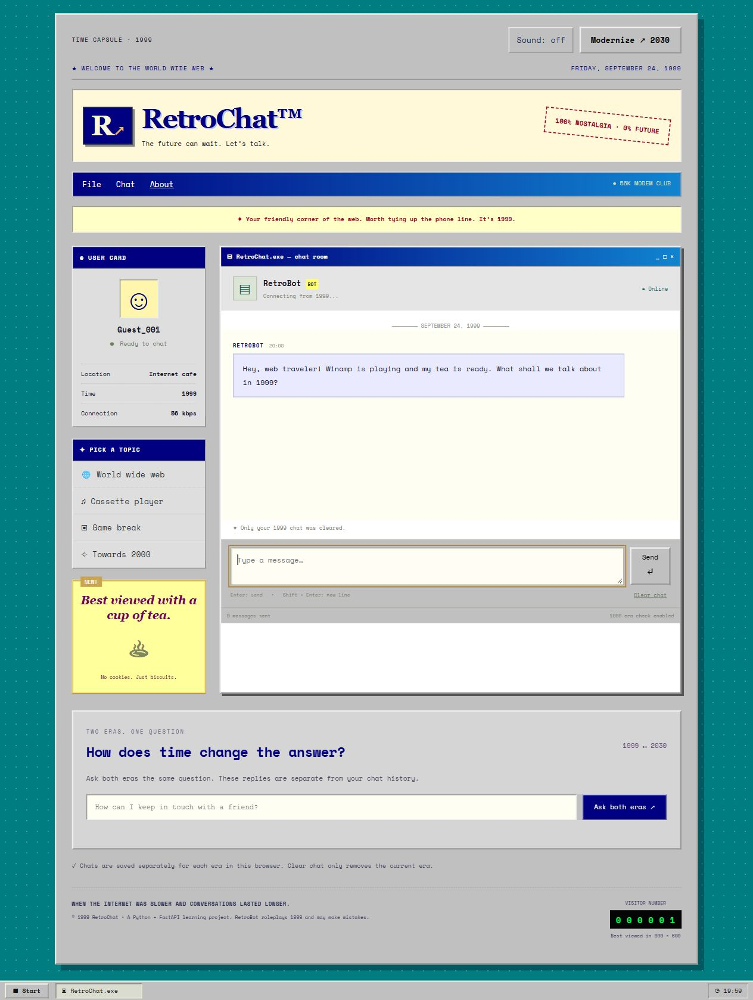
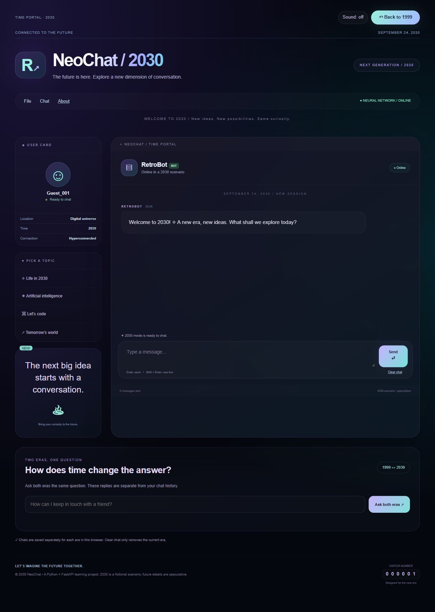

# RetroChat — 1999 ↔ 2030

**One question. Two eras.** A time-travel chatbot built with Python, FastAPI,
Gemini, and plain HTML, CSS, and JavaScript. Step into a 1999 internet cafe,
then jump into a fictional 2030 and see how the conversation changes.

## Preview

### The 1999 internet cafe



### The 2030 theme and comparison workspace



## Features

- **Two eras:** switch between a nostalgic 1999 interface and a futuristic 2030 theme.
- **Time portal:** animated transitions that respect reduced-motion preferences.
- **Optional sounds:** era-specific key and notification tones made with Web Audio; off by default.
- **Compare answers:** ask both eras the same question and view the replies side by side.
- **Streaming replies:** real Gemini output appears as complete sentences become available.
- **Separate chat history:** each era retains up to 50 question-and-answer pairs and its own draft in this browser.
- **Era checks:** system instructions and a small sentence filter help avoid known anachronisms.
- **Connection recovery:** alternate Gemini models and a retry button for temporary failures.

The 2030 setting is **fiction / speculation**. Era checks are best-effort safeguards,
not a comprehensive historical fact-checking system. Model responses may be inaccurate.
The interface and default chatbot language are English; users can explicitly request another response language.

## Stack

| Layer | Technology |
| --- | --- |
| Backend | Python 3.12, FastAPI, Uvicorn |
| AI | Gemini REST API, HTTPX |
| Frontend | HTML, CSS, JavaScript, Web Audio |
| Persistence | Browser localStorage |
| Tests | unittest, HTTPX MockTransport |

No frontend framework, build step, database, or JavaScript package installation is required.

## Quick start

You need Python 3.12 and your own Gemini API key. Get a key through
[Google AI Studio](https://aistudio.google.com/api-keys). Available models and quotas
depend on your account; real API calls may incur costs.

Download or clone this repository, then open a terminal in the project directory.

### Windows / PowerShell

```powershell
python -m venv .venv
.\.venv\Scripts\python -m pip install -r requirements.txt
Copy-Item .env.example .env
```

If `python` is unavailable on Windows, try `py -3.12` in the first command.

### macOS / Linux

```bash
python3 -m venv .venv
.venv/bin/python -m pip install -r requirements.txt
cp .env.example .env
```

Copy the example only during the first setup; do not overwrite an existing `.env`.
Edit `.env` and fill in the empty `GEMINI_API_KEY` value with your own key:

```dotenv
GEMINI_API_KEY=
GEMINI_MODEL=gemini-flash-lite-latest
GEMINI_FALLBACK_MODELS=gemini-3.5-flash-lite,gemini-3.1-flash-lite
```

These model names are configurable examples. Choose models available to your account;
the version behind a `latest` alias can change. Restart the server after changing `.env`.

### Run

```powershell
# Windows
.\.venv\Scripts\python -m uvicorn main:app --reload
```

```bash
# macOS / Linux
.venv/bin/python -m uvicorn main:app --reload
```

Open [localhost:8000](http://127.0.0.1:8000).
Interactive API documentation is at [localhost:8000/docs](http://127.0.0.1:8000/docs).

## Using the app

1. Write a message. Enter sends; Shift + Enter inserts a new line.
2. Select **Modernize** to enter 2030, or **Back to 1999** to return.
3. Use **Sound** to enable or mute era-specific tones.
4. Scroll to **Two eras, one question** to compare both perspectives.

Each era's conversation and draft are stored separately. **Clear chat** removes
only the selected era's history. Clearing browser data also removes saved chats.
Comparison replies and failed or incomplete responses are not added to chat history.
Existing saved messages keep their original text when the interface language changes.

## Tests

```powershell
# Windows
.\.venv\Scripts\python -m unittest -v
.\.venv\Scripts\python scripts/check_repository.py
```

Use `.venv/bin/python` for the same commands on macOS / Linux.
API tests mock Gemini responses: no real API key or paid call is needed.
The repository check requires files to be tracked or staged in Git.

GitHub Actions is configured to run the tests and repository-file check on every
push and pull request. The workflow uses the official
[setup-python action](https://github.com/actions/setup-python).

The optional `check_models.py` script makes real Gemini requests and may use quota.

## API

| Endpoint | Purpose |
| --- | --- |
| `GET /api/status` | Reports whether a key is configured; does not verify its validity |
| `POST /api/chat` | Returns one JSON response |
| `POST /api/chat/stream` | Returns NDJSON events: `meta`, `delta`, `done`, or `error` |

Both chat endpoints accept `era` (`1999` or `2030`) and `messages`.
Messages must alternate between `user` and `model`, ending with `user`.

```json
{"era":"1999","messages":[{"role":"user","text":"What year is it?"}]}
```

The server sends prompts to Gemini using the
[generateContent and streamGenerateContent APIs](https://ai.google.dev/api/generate-content).

## Project structure

```text
main.py                       FastAPI, Gemini connection, era instructions and checks
static/                       HTML, CSS, and JavaScript interface
requirements.txt              Python dependencies
test_app.py                   JSON API tests
test_stream.py                Streaming and era-filter tests
scripts/check_repository.py   Basic secret and private-file check for the Git index
.github/workflows/tests.yml   Automated test workflow
.env.example                  Configuration template with an empty API key
LICENSE                       MIT license
```

## API keys and publishing

- Keep `.env` on your own machine. It is excluded by `.gitignore`.
- Share `.env.example` with an empty key. Each user supplies their own key.
- API keys stay on the server; user messages are sent to Gemini to generate replies.
- `scripts/check_repository.py` checks staged/tracked files, not all Git history or every possible type of secret.
- If a key has already been published, revoke it and create a replacement. Deleting the file alone is not enough.

This is a **local educational project**. Publishing the source on GitHub is different
from hosting a public instance. Before exposing the server publicly, add authentication,
rate limiting, and cost controls. GitHub Pages cannot run this Python backend.
The frontend optionally loads a font from Google Fonts and falls back to local fonts.

## Contributing

Bug reports and pull requests are welcome. See [CONTRIBUTING.md](CONTRIBUTING.md)
for the local checks and contribution workflow.

## License

[MIT](LICENSE). This independent educational project is not affiliated with Google.
Gemini belongs to its respective owner.
